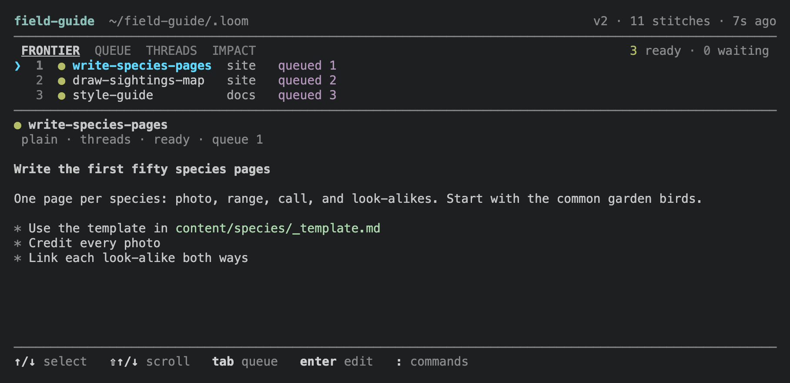

# EasyLoom

A terminal viewer and controller for a [loom](https://github.com/zealtv/loom),
the file-based protocol for planning and tending chains of work: goals,
stitches, dependencies and a queue, kept as plain directories in `.loom/`.
EasyLoom is one static Go binary.



## Install

With Go 1.24 or later:

```sh
go install github.com/zealtv/easyloom/cmd/easyloom@latest
```

Or, from a clone, run `./install.sh`. It builds `bin/easyloom` and links it
into `GOBIN`, or into the directory you give it: `./install.sh ~/.local/bin`.
`make` builds `bin/easyloom` without linking it anywhere.

## Usage

Run `easyloom` inside a repository that has a loom, or `easyloom <path>`.
With no path it uses `$LOOM_DIR` if that is set, and otherwise walks up from
the working directory.

`tab` cycles through four views:

- **frontier**: the work that is ready now
- **queue**: the queue, in order
- **threads**: the whole tree, with dependencies
- **impact**: what resolving each stitch would make ready

`↑`/`↓` selects a stitch and `enter` opens it in `$EDITOR`. `:` opens the
command palette, which claims, ties off, parks, tends, drops and queues
stitches by running the loom's own script. It also reorders the queue, undoes
the last queue move, and quits. EasyLoom follows changes on disk as they
happen.

EasyLoom needs a loom in format v2. Given a v1 loom, it explains that it
can't drive it and points you at loom's `migrate-v2 --dry-run`.

## Issues and contributions

Issues are welcome. Pull requests aren't accepted for now.

## Licence

GPL-3.0-or-later. See [LICENSE](LICENSE).
